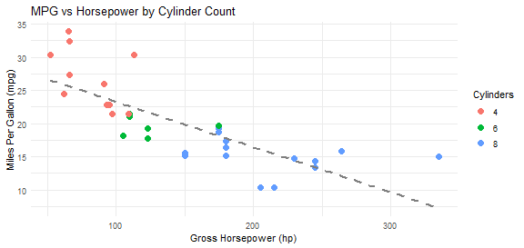

## Executive Summary & Overview

### **The Problem & Solution**
Vehicle fuel efficiency (MPG) depends on multiple physical and mechanical factors. Estimating expected fuel consumption helps drivers and buyers assess performance.

- **Objective**: Provide an interactive tool to predict fuel efficiency based on vehicle specifications.
- **Data Source**: 1974 *Motor Trend* US magazine dataset (`mtcars`).
- **Interactive App**: Built with R Shiny, allowing users to manipulate sliders and radio buttons to predict MPG in real-time.

---

## The mtcars Dataset & Exploratory Analysis

The `mtcars` dataset comprises fuel consumption and 10 aspects of automobile design and performance for 32 automobiles (1973–74 models).


``` r
# Overview of key variables in mtcars
summary(mtcars[, c("mpg", "hp", "wt", "cyl", "am")])
```

```
##       mpg              hp              wt             cyl       
##  Min.   :10.40   Min.   : 52.0   Min.   :1.513   Min.   :4.000  
##  1st Qu.:15.43   1st Qu.: 96.5   1st Qu.:2.581   1st Qu.:4.000  
##  Median :19.20   Median :123.0   Median :3.325   Median :6.000  
##  Mean   :20.09   Mean   :146.7   Mean   :3.217   Mean   :6.188  
##  3rd Qu.:22.80   3rd Qu.:180.0   3rd Qu.:3.610   3rd Qu.:8.000  
##  Max.   :33.90   Max.   :335.0   Max.   :5.424   Max.   :8.000  
##        am        
##  Min.   :0.0000  
##  1st Qu.:0.0000  
##  Median :0.0000  
##  Mean   :0.4062  
##  3rd Qu.:1.0000  
##  Max.   :1.0000
```

- Key predictors: **Horsepower (`hp`)**, **Weight (`wt`)**, **Cylinders (`cyl`)**, and **Transmission (`am`)**.

---

## Predictive Statistical Model

We fit a multivariate linear model to calculate predicted MPG based on user inputs:


``` r
# Fit multivariate linear regression model
fit <- lm(mpg ~ hp + wt + factor(cyl) + factor(am), data = mtcars)
coef(summary(fit))
```

```
##                 Estimate Std. Error   t value     Pr(>|t|)
## (Intercept)  33.70832390 2.60488618 12.940421 7.733392e-13
## hp           -0.03210943 0.01369257 -2.345025 2.693461e-02
## wt           -2.49682942 0.88558779 -2.819404 9.081408e-03
## factor(cyl)6 -3.03134449 1.40728351 -2.154040 4.068272e-02
## factor(cyl)8 -2.16367532 2.28425172 -0.947214 3.522509e-01
## factor(am)1   1.80921138 1.39630450  1.295714 2.064597e-01
```

- Higher horsepower and weight significantly decrease predicted MPG.
- The model is calculated reactively inside `server.R` whenever input widgets change.

---

## Visualizing Model Performance

Below is an embedded live plot demonstrating the relationship between Horsepower and MPG across different cylinder counts:


``` r
ggplot(mtcars, aes(x = hp, y = mpg, color = factor(cyl))) +
  geom_point(size = 3) +
  geom_smooth(method = "lm", se = FALSE, color = "gray50", linetype = "dashed") +
  theme_minimal() +
  labs(title = "MPG vs Horsepower by Cylinder Count",
       x = "Gross Horsepower (hp)", y = "Miles Per Gallon (mpg)", color = "Cylinders")
```

```
## `geom_smooth()` using formula = 'y ~ x'
```



---

## Shiny App Link & Repository

### **Try the Interactive App & Access Code**

- **Shiny Application URL**:  
  [https://buddywhitman.shinyapps.io/courseprojectshiny/](https://buddywhitman.shinyapps.io/courseprojectshiny/)

- **GitHub Code Repository**:  
  [https://github.com/buddywhitman/courseprojectshiny](https://github.com/buddywhitman/courseprojectshiny)

- **Key App Features**:
  1. Interactive Sliders (Horsepower, Weight) & Radio Buttons (Cylinders, Transmission).
  2. Dynamic calculation of predicted MPG with visual highlight on scatter plot.
  3. Built-in documentation tab on the Shiny website itself.
